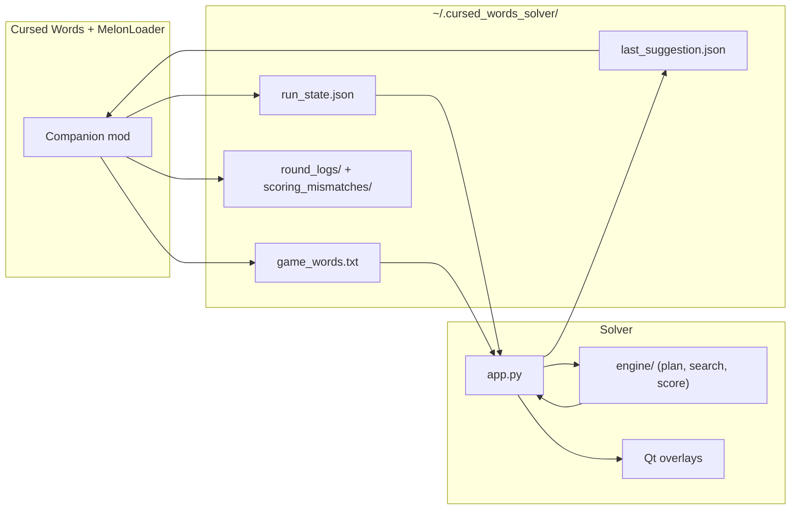

# Cursed Words Solver

A desktop assistant for **Cursed Words: The Word Game That Isn't**. Press **F8** during a run
and it finds the highest-scoring word the game will accept on the current board, then draws
the click path on top of the game.

- **Exact.** Movement, word validity and scoring are ports of the game's own code
  (`ScoreCalculation`, every item hook, `GetValidNextTiles`, `Vocabulary`), so every
  suggestion is a path the game accepts, ranked by the score the game will give it.
- **Live.** A MelonLoader companion mod reads the board, loadout and the game's own word
  list from memory. Nothing is screen-scraped.
- **Checked against the game.** Every submit can be captured (predicted vs. actual score,
  per item), and those captures are the regression tests.

## Play

Install the Thunderstore package and launch the game. The companion mod starts the bundled
solver, so there is no terminal step. Press **F8** during a run.

- Install (mod manager or manual) and what to attach to a bug report:
  [thunderstore/README.md](thunderstore/README.md)
- Bugs: [GitHub issues](https://github.com/SleepyFinale/cursed-words-solver/issues)

| Key          | Where     | Action                                                      |
| ------------ | --------- | ----------------------------------------------------------- |
| F8           | Solver    | Solve the current board (configurable)                      |
| F7           | In-game   | Force a mod export (board, loadout, `game_words.txt`)       |
| F9           | Solver    | Edit the loadout by hand                                    |
| F10          | Solver    | Manual overlay calibration (only if the mod has no layout)  |
| ESC          | Solver    | Hide the overlay and board highlights                       |
| Ctrl+Shift+Q | Solver    | Quit                                                        |

## Develop

Use **Python 3.11 or 3.12** from the repository root:

```powershell
py -3.11 -m venv .venv
.venv\Scripts\activate
pip install -e ".[dev,fast]"
```

`fast` adds numba, which compiles the letter DFS and node-set DFS for deterministic searches
(simulator and training, tests, shop probes). It is optional: without it the same Python code
runs with identical results, and simulator steps are noticeably slower.

Install MelonLoader and build the companion mod (close the game first; `-GameDir` if Steam is
not in the default place):

```powershell
.\melmod\install-melonloader.ps1
.\melmod\build.ps1
```

Then run the solver from the venv and press F8 in a run:

```powershell
cursed-solver
```

A development DLL copied into `Mods\` does not start Python, so start `cursed-solver` yourself.
Mod details and the `run_state.json` schema are in [melmod/README.md](melmod/README.md).

### Tests

```powershell
pytest tests -n 6            # whole suite (pytest-xdist), ~8 min with the game word list
pytest tests/engine          # engine: scoring, movement, search
pytest tests -m slow         # search benchmarks (excluded by default)
```

CI runs `pytest tests/` on Linux without a game word list. To reproduce it locally, point
`HOME` and `USERPROFILE` at an empty folder. Long-standing capture gaps are listed in
[tests/known_failing_tests.txt](tests/known_failing_tests.txt) and run as non-strict xfail.

## How it works

The game, the mod and the solver talk only through files in `%USERPROFILE%\.cursed_words_solver\`.
There are no sockets, and no Python runs inside the game process.



One F8 press:

1. **Export.** The solver writes `f8_export_request.json`; the mod exports the live state and
   acknowledges it. [`f8_snapshot.py`](cursed_words_solver/f8_snapshot.py) waits until the board
   and every extra the loadout needs are present. The game export is the source of truth.
2. **Plan.** [`EnginePlan.build`](cursed_words_solver/engine/calc.py) resolves the loadout once:
   items and their states, bosses, the active challenge, previous words, accumulator words.
3. **Search.** [`ExactSearch`](cursed_words_solver/engine/search.py) finds and exactly scores
   the best paths (see below), spread over a process pool by start tile.
4. **Consumables.** [`consumable_placement.py`](cursed_words_solver/consumable_placement.py) tries
   placing rack tiles when that scores more or rescues a target.
5. **Output.** The best word is re-scored with a full per-item trace, written to
   `last_suggestion.json` and drawn on the board. After you submit, the mod compares the game's
   score with the prediction and logs the round.

### The search

Most boards are searched exhaustively in well under a second. Boards full of wildcards,
chess pieces or Full Moon links have far too many paths to list, so the search works in tiers:

| Stage | What it does |
| --- | --- |
| Letter DFS | Trie-guided DFS over every legal path, to a node budget per start tile |
| Node-set DFS | The same walk with *sets* of trie nodes, so a wildcard costs one step instead of 26. Sets are interned and transitions memoised per trie, so millions of tile paths share a few thousand sets |
| Beam | Grows paths one legal move at a time, scores every extension exactly and keeps the best; widens 64 → 4096 and stops once two passes at width 512 or more find nothing better |
| Shortlist + exact scoring | Every path found is validated exactly (path-dependent inventory, Number Go Up, Honeypot splits) and scored by the engine |

Enumeration stops at fixed work budgets. The time budget (`search_time_budget_sec`, default 60 s)
is only a safety cap. Details: [docs/SEARCH_ARCHITECTURE.md](docs/SEARCH_ARCHITECTURE.md).

### Performance notes (2026-11 review)

On wildcard-heavy boards the time went to the combinatorics, not to Python. Every tile path
carried its own copy of a trie-node set that, with wildcards, covers a whole trie depth. The
compiled numba kernel was only 2.3x faster than numpy at that, because the work itself was
redundant. Interning those sets and memoising their transitions made that stage about 100x
faster with identical results. The beam also stopped re-deriving words from the trie root.

- **Scorer tuning (exact).** The fast scorer builds each call's context from a per-plan
  template, resolves scattered items and selections once per plan, and uses tighter Dusty
  Coffin, Fire Extinguisher, Yellow Glasses and Maple Leaf hooks with the same arithmetic.
  That is about 30% less time per score and about 11% more training steps/s. It gives the
  same result on all 196,728 recorded training score calls and every capture.
- **C++ scorer: not worth it now.** Unprofiled, scoring is about 35% of a training step; the
  rest is simulator bookkeeping, state clones and enumeration. So even an infinitely fast
  native scorer caps out near 1.5x end to end. It would also need a C++ compiler on every dev
  machine and a C++ copy of about 240 item hooks, re-ported on every game update. Bigger,
  cheaper wins are in the simulator (reusing search results at submit, cheaper state clones).
  If scoring is still the bottleneck after those, the next step is a numba batch scorer that
  sends any plan it can't handle back to Python, not C++.
- **GPU: not a fit.** The search is a branchy tree walk with tiny per-node work and a
  Python-side scorer. Kernel launch latency and divergence would cost more than they save,
  and CUDA would add gigabytes to the bundled solver.

## Runtime files

All under `%USERPROFILE%\.cursed_words_solver\`:

| File / folder | Written by | Purpose |
| --- | --- | --- |
| `config.json` | Solver | Settings (below) |
| `run_state.json` | Mod | Live board, loadout, extras, UI layout |
| `game_words.txt` | Mod | The game's word list (ENABLE1 is the offline fallback) |
| `f8_export_request.json` | Solver | Asks the mod for a fresh export on each F8 |
| `last_suggestion.json` | Solver | Suggested path, predicted score and trace, `search` timing |
| `round_logs/` | Mod | One JSON per submit: state, submission, prediction, `solver.search` timing |
| `scoring_mismatches/` | Mod | Submits where the game's score differed from the prediction |
| `solver.log` | Bundled solver | Solver output when started by the mod |
| `debug/` | Solver | Traces, board captures, calibration preview |

## Config

`config.json`:

| Key | Default | Purpose |
| --- | --- | --- |
| `hotkey` | `f8` | Solve hotkey |
| `search_time_budget_sec` | `60` | Safety cap per solve. Most boards finish long before it |
| `search_workers` | `"auto"` | Search processes: `"auto"` (up to 8), `1` for serial, or `2`–`16` |
| `top_n_results` | `3` | Alternate words in the overlay |
| `wordlist` | `game` | `game` uses `game_words.txt`; `enable1` is the offline fallback |
| `show_board_highlight` | `true` | Numbered circles on the board and the consumable rack |
| `grid_reroll_gap_ratio` | `0.3` | Suggest a grid reroll below this fraction of the target |
| `board_region` / `rack_region` | none | Manual overlay regions, used only when the mod sends no layout |

## Troubleshooting

- **F8 does nothing / "no board".** The mod only exports during a run. Start a round, press
  **F7**, then **F8**.
- **Odd or invalid words.** Check that `game_words.txt` exists. The log says `enable1 fallback`
  when the game's word list was never exported; press **F7** in a run.
- **Highlights in the wrong place.** An old mod sends no `ui_layout`; rebuild it, or use **F10**.
- **Slow solves.** The log line `Timing: enumerate …, score …` and `solver.search` in the round
  log show where the time went. Attach the round log to an issue.

## Fixing a scoring or search miss

1. Play the highlighted word. If the game scores it differently, the mod writes a file in
   `scoring_mismatches/`.
2. `python scripts/mismatch_to_test.py <mismatch.json>` turns it into a fixture.
3. Fix the engine from the decompile ([docs/game-research/engine.md](docs/game-research/engine.md)),
   never with a per-capture special case, until `pytest tests/regression -k <id>` passes.

Other tools:

```powershell
python scripts/engine_replay.py                 # score + path validity vs every capture
python scripts/search_benchmark.py --latest 30  # re-solve recent rounds vs what was played
cursed-solver diagnose                          # health report for the last F8 and logs
cursed-solver explain --round-log <file>        # why the solver missed a submitted path
```

More in [scripts/README.md](scripts/README.md).

## Repository layout

```text
cursed_words_solver/
  app.py                 hotkeys, F8 orchestration, Qt bridge, CLI (diagnose / explain)
  search.py              WordSearcher: entry point the app calls
  search_parallel.py     process pool for the search
  engine/                game port: plan + scoring (calc, items, dlc_items), movement and
                         search (search, dlc_search), validity (dlc_rules), trie
  f8_snapshot.py         live export gather for each F8
  loadout.py             run_state.json -> Board / Loadout
  suggestion.py          last_suggestion.json and stale-suggestion checks
  consumable_placement.py  rack tile placement
  cursedle_solver.py     daily fairy trial (Cursedle) word finder
  shop_advisor.py, grid_reroll_advisor.py  shop and reroll advice
  rules/                 boss, quest, stamp and tile metadata used around the engine
  ui/                    overlay, board and rack highlights, calibration
  sim/, rl/              run simulator and AI assistant (experimental)
melmod/                  MelonLoader companion mod (C#) and build / package scripts
thunderstore/            player README, manifest, PyInstaller spec
docs/                    search architecture, game research, decompile notes
scripts/                 replay, benchmark, fixture and catalog tools
tests/                   engine, regression captures, integration, sim, unit tests
```

## Further reading

- [docs/SEARCH_ARCHITECTURE.md](docs/SEARCH_ARCHITECTURE.md): search tiers, budgets, DLC search
- [docs/game-research/engine.md](docs/game-research/engine.md): the game-port engine and capture format
- [melmod/README.md](melmod/README.md): companion mod install, export schema, round logs
- [melmod/SCORING_HOOKS.md](melmod/SCORING_HOOKS.md): Harmony hooks for score capture
- [docs/game-research/sim-game.md](docs/game-research/sim-game.md): full-run simulator and AI
- [thunderstore/README.md](thunderstore/README.md): player install and bug reports
